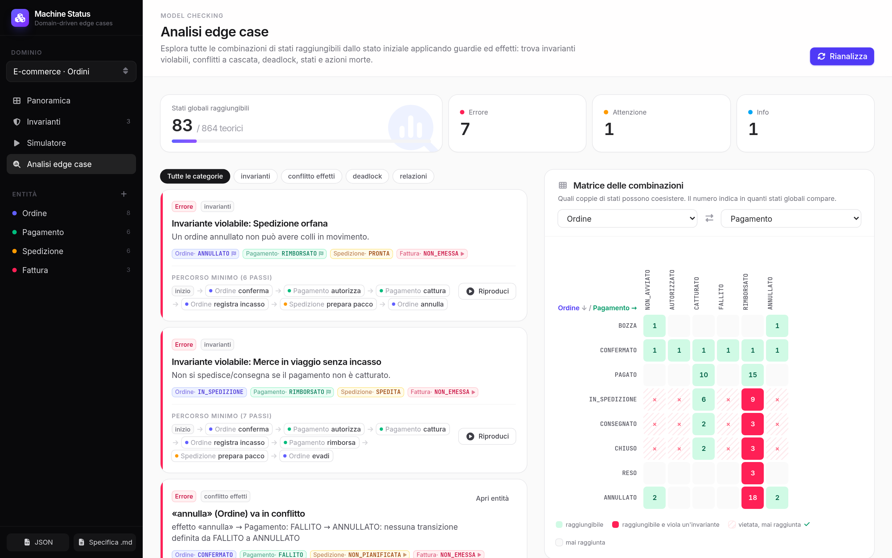
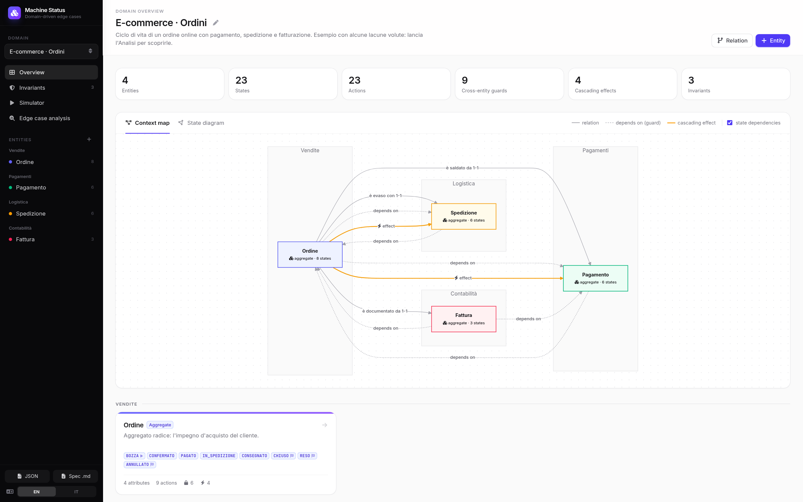
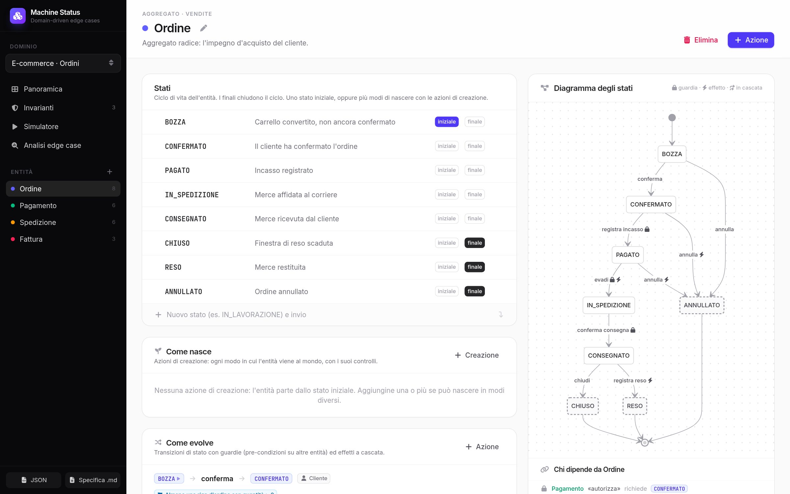
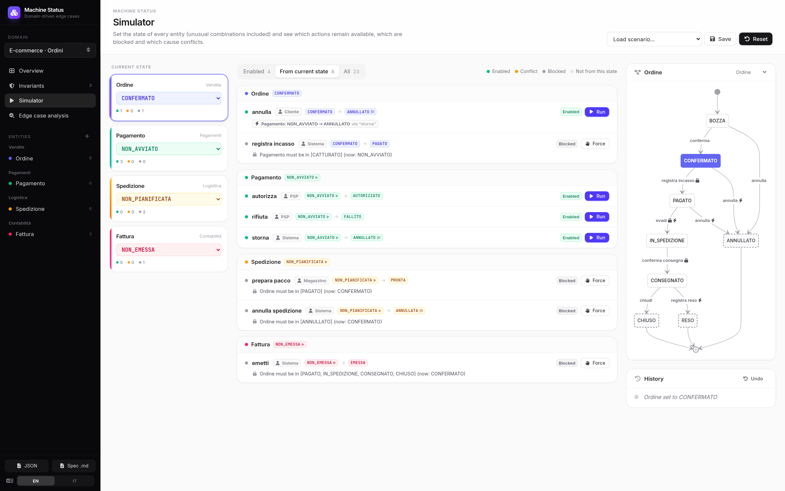

# Machine Status · DDD

**Find the edge cases in your domain model before your users do.**

Machine Status is a modelling tool for functional analysts. You describe a domain the DDD way (aggregates, their lifecycles, the rules that tie them together) and it explores *every* reachable combination of states to tell you where the model breaks: forbidden state combinations that can actually happen, cascading effects that conflict, deadlocks, dead actions, unreachable states.



> The UI is available in **English** and **Italian** (switch from the sidebar). The example domain, an Italian e-commerce order with payment, shipment and invoice, ships with a few deliberate gaps so you can run the analysis and see what it finds.

## Features

### Domain overview
A context map of your entities grouped by bounded context, with declared relations, state dependencies (guards) and cascading effects drawn between them.



### Entity editor
Define states (initial, final; active, off or deleted), creation actions, transitions with guards and cascading effects, and the entity's relations with what each composition implies. A live state diagram, a *states × actions* table that exposes unhandled combinations, and a list of everyone who depends on the entity.



### Simulator
Set any combination of states, even ones that "shouldn't happen", and see which actions are enabled, blocked (and why) or in conflict. Execute, force, undo, save scenarios, and replay any path found by the analysis step by step.



### Edge case analysis
A breadth-first model checker over the global state space (up to 300,000 combinations, cached until the model changes). It reports:

- **Violable invariants**: a sequence of actions reaches a forbidden combination
- **Effect conflicts**: a cascade asks an entity for a transition it can't make
- **Deadlocks**: non-final entities with no enabled action
- **Unreachable states** and **dead actions**
- **Non-determinism**: the same action leading to different states
- **Creations that skip checks** the normal path enforces
- **Broken compositions**: a child alive without its parent
- **Relations without rules** and **undeclared dependencies**

Every finding comes with the **shortest path** that reproduces it, which you can replay in the simulator. A co-existence matrix shows which state pairs of two entities are reachable together.

### Export
JSON (round-trip import) and a functional specification in Markdown, analysis included.

## Concepts

| Concept | Meaning |
|---|---|
| **Entity** | Aggregate, entity or value object, with bounded context, attributes and lifecycle |
| **State** | One initial state, zero or more final states. Each state also says whether the entity is **active** (exists and operates), **off** (disabled but recoverable, e.g. DISABLED) or **deleted** (gone for good, e.g. DELETED) |
| **Creation action** | A way the entity comes into existence: from `DOES_NOT_EXIST` to a state, with its own guards, effects and actor. An entity can have several |
| **Action** | A transition `from → to` (from "any" = from every non-final state), with an actor |
| **State guard** | Precondition: another entity must (or must not) be in given states |
| **Rule** | Free-text business condition, shown as "to be verified" |
| **Cascading effect** | The action forces another entity to change state, run an action or be created. If no valid transition exists, it's a **conflict** |
| **Invariant** | A forbidden combination of states (AND of conditions); may use `DOES_NOT_EXIST` |
| **Composition** | The child cannot exist without the parent. Two invariants follow: a child must be deleted when the parent is deleted (or does not exist), and cannot stay active when the parent is off. The tool also checks that creating the child requires the parent, and that the actions deleting or turning off the parent take care of the children |
| **Multiple instances** | On a composition, simulate 2–3 children per parent in the analysis (e.g. "one item confirmed, the other deleted") |

The simulation model has one instance per entity: a single business case, such as one order with its payment, shipment and invoice.

## Getting started

### Docker (development, hot reload)

```bash
docker compose up -d     # frontend http://localhost:5180 · API http://localhost:8010
docker compose logs -f
```

No image builds: `backend/` and `frontend/` are mounted as volumes, so Uvicorn (`--reload`) and Vite (HMR) pick up every change.

### Without Docker

```bash
./run.sh            # installs deps, builds the frontend if missing, serves on http://localhost:8000
./run.sh --build    # force a frontend rebuild
```

For hot reload, run `uvicorn app.main:app --reload` in `backend/` and `npm run dev` in `frontend/` (http://localhost:5173, `/api` is proxied to port 8000).

The database is `backend/ddd.sqlite3` (override with `DDD_DB`). On first start an example domain is seeded.

## Tech stack

| Layer | Stack |
|---|---|
| Backend | Python, FastAPI, SQLite (no ORM) |
| Engine | Pure Python state machine + BFS model checker (`backend/app/engine.py`, `relations.py`) |
| Frontend | Vue 3, Vue Router, vue-i18n, Tailwind CSS 4, Mermaid, Font Awesome |

```
backend/app/
  engine.py        state machine, cascade propagation, exploration, analysis
  relations.py     compositions, multiple instances, relation checks
  i18n.py          server-side messages (analysis, conflicts, export) in en/it
  db.py            schema, migrations, generic CRUD
  main.py          REST API
  portability.py   JSON import / Markdown export
  seed.py          example domain
frontend/src/
  views/           Home, Model, Entity, Invariants, Simulator, Analysis
  components/      Mermaid, StateChip, StatePicker, Trace, Modal, PageHeader
  locales/         UI translations (en.json, it.json)
  diagrams.js      Mermaid generators (state diagram, context map)
  store.js         reactive store and API client
```

## Contributing

Contributions are welcome! Read [CONTRIBUTING.md](CONTRIBUTING.md) to get started. Commits must be signed off under the [Developer Certificate of Origin](https://developercertificate.org/) (`git commit -s`).

## License

Copyright (C) 2026 Luca Orlandelli

This program is free software: you can redistribute it and/or modify it under the terms of the [GNU Affero General Public License v3.0](LICENSE) as published by the Free Software Foundation.

In short: you can use, modify and share it, but if you distribute it or run a modified version as a network service, you must release your source code under the same license.
